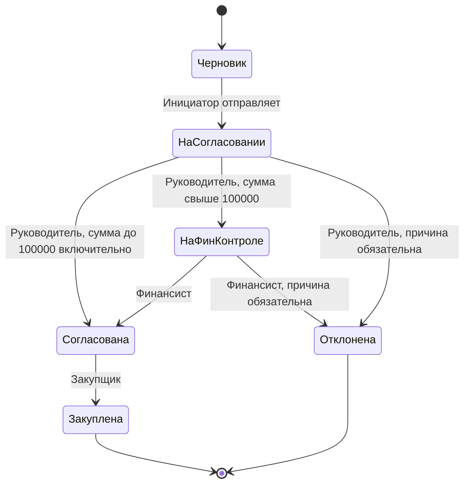

# Согласование закупок на 1С

[](https://github.com/Foam0/onec-purchase-approval/actions/workflows/ci.yml)

Учебная конфигурация для согласования заявок на закупку. Инициатор составляет заявку,
руководитель проверяет её, финансист дополнительно согласует суммы свыше 100 000 рублей,
а закупщик отмечает исполнение. Каждый переход создаёт запись истории в одной транзакции с документом.

**Статус:** исходники для Конфигуратора 1С:Предприятия 8.3; 32 проверки исходного BSL-модуля
исполнены через OneScript. Загрузка XML, компиляция, права пользователей и интеграционные сценарии
на платформе 1С ещё не проверены. OneScript проверяет правила маршрута и суммы, но не заменяет запуск в 1С.

## Что реализовано

- Справочники «Подразделения» и «Номенклатура».
- Документ «Заявка на закупку»: автор, подразделение, обоснование, товары, сумма, статус и версия.
- Подсчёт суммы с округлением каждой строки до копеек.
- Шесть статусов, маршрут согласования и порог дополнительного финансового контроля.
- Роли `Инициатор`, `Руководитель`, `Финансист`, `Закупщик`, `ПолныеПрава`.
- Проверка бизнес-ролей на сервере; запрет согласования собственной заявки для обычных пользователей.
- Проверка ожидаемой версии после блокировки и повторного чтения документа.
- Заморозка содержимого после отправки; запрет прямого изменения статуса через форму документа.
- Непериодический регистр истории с ключом заявка/версия.
- Управляемая форма действий, отчёт СКД «Реестр заявок», демоданные и интеграционные сценарии.

## Маршрут



| Сумма заявки | После руководителя | Дополнительное согласование |
|---|---|---|
| 99 999,99 ₽ | Согласована | Не требуется |
| 100 000,00 ₽ | Согласована | Не требуется |
| 100 000,01 ₽ | На финансовом контроле | Финансист |

## Архитектура

- [ЗакупкиПравила](src/CommonModules/ЗакупкиПравила/Ext/Module.bsl) — сумма, маршрут, роли и сравнение версий;
  этот же файл исполняется в автоматизированных тестах.
- [ЗакупкиСервис](src/CommonModules/ЗакупкиСервис/Ext/Module.bsl) — доступный клиенту серверный интерфейс;
  получает пользователя и роли из сеанса, проверяет типы и комментарий.
- [ЗакупкиХранилищеПолныеПрава](src/CommonModules/ЗакупкиХранилищеПолныеПрава/Ext/Module.bsl) — внутренний
  привилегированный модуль с `ServerCall=false`: блокировка документа, повторное чтение, проверка маршрута,
  запись документа и истории. Клиент не может напрямую передать в этот модуль свои роли.
- [Модуль документа](src/Documents/ЗаявкаНаЗакупку/Ext/ObjectModule.bsl) — защита прямой записи,
  запрет редактирования отправленных заявок и увеличение версии.

Версия увеличивается при каждом сохранении, включая редактирование черновика. Если два пользователя
увидели версию 3, первый переход создаёт версию 4; второй запрос с ожидаемой версией 3 отклоняется.
Ключ истории включает версию, поэтому два действия в одну секунду не перезаписывают друг друга.

## Загрузка в 1С

Целевая среда: 1С:Предприятие 8.3.23+ с управляемым приложением. Конкретная версия платформы
не была проверена; режим совместимости — 8.3.17. Типовая конфигурация и БСП не нужны.

1. Создайте **новую пустую учебную информационную базу**.
2. В Конфигураторе выберите **Конфигурация → Загрузить конфигурацию из файлов** и каталог `src`.
3. Проверьте конфигурацию для тонкого клиента, сервера и внешнего соединения.
4. Обновите конфигурацию базы данных.
5. Создайте пользователя `Администратор` с ролью `ПолныеПрава` и языком `Русский`.
6. Запустите 1С:Предприятие под этим пользователем, откройте раздел «Рабочее место».

В Windows можно использовать [скрипт](scripts/build.ps1), указывая установленную версию платформы:

```powershell
.\scripts\build.ps1 -Platform "C:\Program Files\1cv8\8.3.XX.YYYY\bin\1cv8.exe"
```

Он создаёт отдельную базу и отказывается перезаписывать существующую папку. Проверяйте логи в `build/`.

## Демо на пять минут

1. В обработке «Демонстрация» нажмите **ПроверитьСценарии**. Тестовые данные откатываются.
2. Нажмите **СоздатьДемо**: откроется черновик заявки на ноутбук стоимостью 120 000 ₽, версия 1.
3. Откройте обработку «Согласование», выберите созданную заявку. Версия и статус заполнятся из базы.
4. Последовательно нажмите **Отправить**, **Согласовать**, **Согласовать**, **Закупить**.
5. Итог: «Закуплена», версия 5. Реестр заявок показывает итоговое состояние.

Администратор проходит весь маршрут и может согласовать свою заявку для демонстрации.
Это явное исключение; обычным руководителю и финансисту самосогласование запрещено.

Для проверки защиты от устаревшей версии откройте одну заявку в двух формах «Согласование».
Выполните действие в первой и повторите его во второй: ожидается просьба обновить данные.
Кнопка **Обновить** перечитывает состояние. Счётчик версии нужен для контроля изменений, а не для повторного исполнения команды.

## Проверка ролей

Создайте отдельных пользователей и назначьте каждому ровно одну из бизнес-ролей. **Снимите `ПолныеПрава`**,
если она подставилась как роль по умолчанию. Для проверки запрета самосогласования назначьте тестовому
пользователю одновременно `Инициатор` и `Руководитель`.

| Роль | Разрешённое действие |
|---|---|
| Инициатор | Создаёт и редактирует свой черновик, отправляет свою заявку |
| Руководитель | Согласует или отклоняет чужую заявку на согласовании |
| Финансист | Согласует или отклоняет чужую заявку на финансовом контроле |
| Закупщик | Отмечает закупку согласованной заявки |

Все бизнес-пользователи могут читать общий реестр. Прямой записи истории им не предоставлено;
изменение отправленной заявки выполняет только серверный сервис. Регистры не показываются отдельными
командами в пользовательском интерфейсе. Эти права требуют проверки на платформе.

## Автоматизированные проверки

```bash
python3 scripts/check_metadata.py
oscript tests/run.os
```

Проверяются расчёт и построчное округление суммы, граничное значение 100 000 ₽, разрешённые маршруты,
недостаточные роли, самосогласование, чужая заявка, конечные статусы и устаревшая версия.
Для статического анализа нужны [BSL Language Server 1.0.7](https://github.com/1c-syntax/bsl-language-server/releases/tag/v1.0.7)
и Java 21+. Команды есть в [CI](.github/workflows/ci.yml); [результаты](docs/verification.md).

## Границы проекта

Нет интеграции с почтой, HTTP API, уведомлений, бюджетов подразделений и рабочего календаря.
Порог 100 000 ₽ фиксирован в правилах. Отклонённая заявка терминальна; повторная подача создаёт новый документ.
Физическое удаление документов запрещено. Автор идентифицируется именем пользователя 1С; переименование
учётной записи потребует отдельной миграции. Межподразделенческого ограничения чтения нет.
Администратор имеет полные технические права и может вмешиваться в данные: журнал не является защитой от администратора.
Нагрузочная проверка и гонка в двух реальных сеансах не выполнены.

## Для резюме

> Учебный проект «Согласование закупок» на 1С:Предприятии 8.3: управляемая форма, маршрут по ролям,
> дополнительное согласование по сумме, контроль версий, транзакционная запись истории и отчёт СКД.
> 32 автоматизированные проверки правил на OneScript; исходники и CI опубликованы на GitHub.

[Разбор для собеседования](docs/interview.md).

## Источники и лицензия

Бизнес-код написан для этого проекта. XML-каркасы адаптированы из проверочных конфигураций
`1c-syntax`; [NOTICE.md](NOTICE.md) содержит происхождение и изменения. LGPL-3.0-or-later,
см. [LICENSE](LICENSE) и [COPYING](COPYING).
Принцип внутреннего привилегированного модуля следует [стандарту 1С](https://kb.1ci.com/1C_Enterprise_Platform/Guides/Developer_Guides/1C_Enterprise_Development_Standards/Setting_data_access_rights/Privileged_mode/?language=en).
